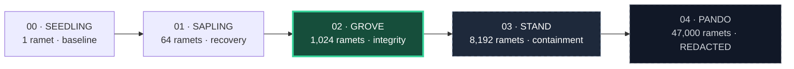

# ASPEN / Mission Roadmap

**INTERNAL // RESTRICTED // ASPEN-COMPARTMENTED**

[Project overview](../README.md) · [Architecture](ARCHITECTURE.md) · [Incident archive](INCIDENTS.md)

> **ACTIVE DOSSIER: GROVE**
>
> One genome. A thousand trunks. No unexplained divergence.
>
> **Next authorization:** STAND · **Primary blocker:** INC-0057 ·
> **Release policy:** evidence before expansion

This roadmap belongs to the fictional ASPEN program. Phase ceilings are targets,
not measured capacity. SEEDLING and SAPLING are complete in the narrative;
their exit criteria still need reproducible evidence in this repository.
Unchecked items below are planned work, not implemented capabilities.

## Mission trajectory



| Phase | Ceiling | Program status | Exit gate | Review owner¹ |
|-------|--------:|----------------|-----------|---------------|
| **00 · SEEDLING** | 1 | Narrative complete | Single ramet serves ≥90% of fixed baseline demand | `@aspen-lead` |
| **01 · SAPLING** | 64 | Narrative complete | Recover pre-fire satisfaction within 5 epochs after an 80% fire | `@root-systems` |
| **02 · GROVE** | 1,024 | Active; promotion blocked | Resolve INC-0057 and demonstrate consistent fingerprints over a 30-day live observation window | `@root-systems` |
| **03 · STAND** | 8,192 | Awaiting GROVE approval | Containment red-team sign-off and worst observed firebreak latency <200 ms on the declared test matrix | `@aspen-contain` |
| **04 · PANDO** | 47,000 | Compartmented | ████████████████████ · release criteria withheld | `@aspen-contain` |

¹ Fictional review roles from the project briefing, not actual assignments.
Phase promotion requires the program lead and Containment Board to accept the
same evidence packet. Dates are not committed until prerequisites are met.

## GROVE work queue

Work in this order. Each deliverable should be reviewable independently.

| Priority | Deliverable | Done when | Dependency |
|----------|-------------|-----------|------------|
| **P0** | Investigate [INC-0057](INCIDENTS.md#inc-0057-genome-fingerprint-drift) | A reproduction or documented explanation, regression coverage, and incident disposition are recorded | First action; hot reload remains frozen in the storyline |
| **P0** | Capture repeatable run evidence | Reports include seed, config, revision, epoch count, demand satisfaction, population, and fingerprint checks | Agreed report format |
| **P1** | Establish the recovery baseline | An automated 80% fire drill returns to pre-fire satisfaction within 5 epochs under fixed demand, without losing stored nutrients | Repeatable reports |
| **P1** | Exercise GROVE containment | Ceiling, per-epoch spawn cap, growth ratio, and both firebreak triggers are checked under sustained demand | Repeatable reports |
| **P1** | Define the integrity soak | Sampling cadence, restart behavior, failure conditions, and evidence retention are documented before the run | INC-0057 disposition |
| **P2** | Assemble the STAND review packet | All GROVE evidence is linked, limitations are explicit, and the promotion decision is recorded | All preceding deliverables |

**Scope boundary:** the current repo is an in-memory, epoch-based simulator.
It has no live deployment or hot-reload system, so a local run cannot establish
the 30-day live gate or reproduce the incident's described environment.
Define that harness before claiming program-level validation.

## Gate evidence checklist

Attach this information to each proposed phase promotion:

- [ ] **Identity:** source revision, Python version, configuration, and random seed.
- [ ] **Protocol:** workload, duration, measurement method, and pass/fail threshold fixed before execution.
- [ ] **Results:** measured values and raw output, including failures and reruns.
- [ ] **Containment:** observed population and spawn bounds; environment and file firebreak results.
- [ ] **Recovery:** pre-fire satisfaction, actual fraction burned, epochs to recovery, and retained nutrients.
- [ ] **Integrity:** fingerprint samples and any divergence, with incident links.
- [ ] **Decision:** reviewer, accepted limitations, and advance / hold / repeat outcome.

For SEEDLING, use fixed demand and state the measurement window. For SAPLING,
freeze demand growth so that recovery is compared against the same workload.
For STAND, measure from firebreak activation to blocked growth, declare the
hardware and load, and report the maximum across the test matrix. A single
passing run does not establish the gate.

## What the repository demonstrates today

The [existing tests](../tests/test_colony.py) exercise single-seed initialization,
growth under demand, shared fingerprints, population ceilings, the environment
firebreak, invalid token rejection, nutrient retention after total fire, sprout
bonuses, and normalized expression weights.

They do **not** yet establish the 90% baseline, five-epoch recovery, 30-day
integrity, or sub-200 ms firebreak targets. Token validation is a simulator
placeholder that checks a prefix; signed authorization is a future program
requirement. The [PANDO config](../configs/pando.yaml) is a redacted prop and
is rejected by the CLI.

To inspect the active sandbox configuration after the
[quickstart](../README.md#quickstart-sandbox-only):

```bash
aspen status --config configs/grove.yaml
aspen grow --config configs/grove.yaml --epochs 30
pytest -q
```

These commands are smoke checks, not a phase certification.

## Research annex / deferred work

| Question | Current disposition | Evidence needed to revisit |
|----------|---------------------|----------------------------|
| Can different genomes share a rhizome? | **Cross-grafting forbidden** in the program design | Isolation model and explicit containment review |
| When does a new ramet outperform the seed? | Open hypothesis; the previous ~3,000 nutrient estimate is unverified | Domain-specific benchmark against the same demand and genome |
| Can one colony become two independent colonies? | **Project CUTTING — not started** | State ownership, split semantics, and recovery experiment |
| What happens beyond STAND? | **PANDO — compartmented** | Accepted STAND evidence; further criteria remain redacted |

---

*The forest can wait. The evidence cannot.*
